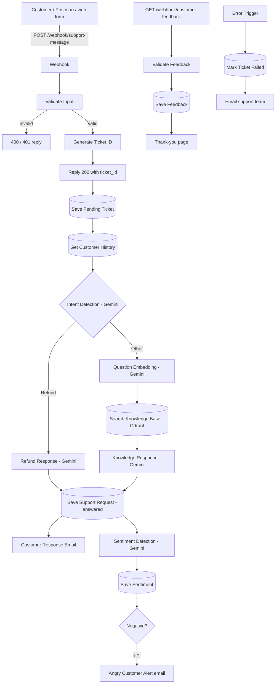

# AI Customer Support Automation Platform


An AI-powered customer support system built with **n8n, Google Gemini, Qdrant and PostgreSQL**, running entirely in Docker on your own machine.

A customer sends a message to a webhook. The system opens a ticket, looks up the customer's past tickets, works out what they want, answers from a company knowledge base (RAG), checks how they feel, emails the reply, and alerts the support team if the customer is angry. Every email carries feedback links, and the ratings are stored for later analysis.

Author: **Hansi Tharaki**, Software Engineering Undergraduate.

---

## Contents

- [What it does](#what-it-does)
- [Architecture](#architecture)
- [Tech stack](#tech-stack)
- [Getting started](#getting-started)
- [Configuration](#configuration)
- [API](#api)
- [Ticket lifecycle and failure handling](#ticket-lifecycle-and-failure-handling)
- [Knowledge base](#knowledge-base)
- [Database schema](#database-schema)
- [Testing](#testing)
- [Project layout](#project-layout)
- [Known limitations](#known-limitations)
- [License](#license)

---

## What it does

1. **Receives** a support message at `POST /webhook/support-message` and validates it (email, message length).
2. **Creates a ticket** with an ID such as `SUP-2026-000123` (from a PostgreSQL sequence) and replies `202` straight away. The rest runs in the background.
3. **Recalls history**: the customer's last 5 answered tickets are given to the AI as context.
4. **Detects intent** with Gemini. Refund requests get a policy-based reply. Everything else goes through RAG.
5. **Searches the knowledge base**: the question is embedded and matched against FAQ documents in Qdrant.
6. **Writes the reply** with Gemini, signed by the support agent, and saves it to the ticket.
7. **Emails the customer**, including "Was this helpful?" links.
8. **Detects sentiment** (`Positive`, `Neutral`, `Negative`), stores it, and emails the support team when it is negative.
9. **Collects feedback** at `GET /webhook/customer-feedback` and stores the rating and optional comment.
10. **Reports failures**: if any step fails after all retries, the ticket is marked `failed` and the support team gets an email with the ticket number, customer address and message.

## Architecture



All of this is one n8n workflow named **Customer Support AI** (id `CdAypnWR7xBZIEPc`), stored in [n8n/backup/workflows/Customer Support AI.json](n8n/backup/workflows/Customer%20Support%20AI.json). `scripts\setup.ps1` imports and publishes it.

## Tech stack

| Part | Technology |
|---|---|
| Workflow engine | n8n 2.44.6 |
| AI | Google Gemini through its OpenAI-compatible API (chat and 1536-dimension embeddings). No OpenAI key is used. |
| Vector database | Qdrant v1.20.0 (collection `support_docs`) |
| Database | PostgreSQL 16 |
| Packaging | Docker Compose |
| Glue | PowerShell scripts, JavaScript in n8n Code nodes |
| API tests | Postman collection, runnable with Newman |

## Getting started

You need Docker Desktop (running), PowerShell, and a [Gemini API key](https://aistudio.google.com/apikey). Run from the project folder:

```powershell
copy .env.example .env                 # then put your GEMINI_API_KEY in .env
.\scripts\setup.ps1                    # starts the stack, imports + publishes the workflow, prepares the database
.\scripts\test-gemini.ps1              # checks the key (chat + embeddings)
.\scripts\ingest-knowledge-base.ps1    # loads knowledge_base\faq.txt into Qdrant (first time only)
.\scripts\test-webhooks.ps1            # end-to-end test of both webhooks (pass/fail)
```

If PowerShell blocks the scripts, run them as `powershell -ExecutionPolicy Bypass -File .\scripts\setup.ps1`.

n8n is at http://localhost:5678 (the first visit asks you to create the owner account). All ports are bound to `127.0.0.1`, so nothing is reachable from other machines.

Everyday commands:

```powershell
docker compose up -d                   # start
docker compose ps                      # status
docker compose logs n8n --tail 50      # logs
docker compose stop                    # stop (keeps all data)
```

Do not run `docker compose down -v`: it deletes the database and Qdrant volumes.

**Changing the workflow.** The running copy lives in n8n's database, not in the JSON file. After editing [Customer Support AI.json](n8n/backup/workflows/Customer%20Support%20AI.json) (for example the email signature), run `.\scripts\setup.ps1` again to import it. Restarting the containers alone does not apply the change.

## Configuration

Everything is set in `.env` (copied from [.env.example](.env.example); `.env` is git-ignored).

| Setting | Purpose |
|---|---|
| `GEMINI_API_KEY` | Required for all AI steps |
| `GEMINI_CHAT_MODEL`, `GEMINI_EMBEDDING_MODEL` | Models used (defaults in `.env.example`) |
| `GEMINI_FALLBACK_MODEL` | Tried automatically when the main chat model is overloaded or keeps failing |
| `SMTP_HOST`, `SMTP_PORT`, `SMTP_USER`, `SMTP_PASSWORD`, `SMTP_FROM` | Sending real emails. Without SMTP the email steps fail quietly and everything else still runs. For Gmail use `smtp.gmail.com` and an App Password. |
| `SUPPORT_ALERT_EMAIL` | Where angry-customer and error alerts go |
| `SUPPORT_API_KEY` | When set, `POST /webhook/support-message` must send the header `X-API-Key` |
| `WEBHOOK_URL` | Public address used in the feedback links inside emails. Use a URL your customers can reach, not `localhost`, in production. |
| `POSTGRES_PASSWORD` | Database password (only applied when the volume is first created) |
| `N8N_HOST_PORT`, `POSTGRES_HOST_PORT`, `QDRANT_HOST_PORT` | Host ports |

SMTP settings are copied into n8n by `setup.ps1`, so re-run it after changing them.

The email sign-off is written into the Gemini prompts in the workflow:

```
Support Agent: Hansi Tharaki
Position: Software Engineering Undergraduate
Company: Smart Support AI Solutions
Contact: tharaki115h@gmail.com
```

## API

| Endpoint | Purpose | Replies |
|---|---|---|
| `POST /webhook/support-message` | JSON body `{ "name": "Jane", "email": "jane@example.com", "message": "..." }`. Also reachable as `/webhook/support-request`. | `202 {"status":"accepted","ticket_id":"SUP-2026-000123"}` straight away. `400` for invalid input (valid email and message required, message at most 2000 characters, name at most 100). `401` for a wrong or missing `X-API-Key`. |
| `GET /webhook/customer-feedback?ticket_id=...&rating=good\|bad[&feedback=...]` | Stores a rating (and optional comment up to 500 characters) for an existing ticket | `200` thank-you page, `400` invalid link, `404` unknown ticket |

Example (PowerShell):

```powershell
. .\scripts\load-env.ps1
$headers = @{}
if ($env:SUPPORT_API_KEY) { $headers['X-API-Key'] = $env:SUPPORT_API_KEY }
$body = @{ name = 'Jane'; email = 'jane@example.com'; message = 'How do I reset my password?' } | ConvertTo-Json
Invoke-RestMethod -Method Post http://localhost:5678/webhook/support-message -ContentType application/json -Headers $headers -Body $body
```

More examples are in [codes.txt](codes.txt). A ready-made Postman collection is in [postman/](postman/AI-Customer-Support.postman_collection.json).

**Testing from the n8n editor.** Calls to `/webhook/...` never appear on the canvas; open the **Executions** tab to see them, and use **Debug in editor** to load one. The **Execute** button with the *Webhook* trigger selected waits up to 2 minutes for one request to `http://localhost:5678/webhook-test/support-message` (same body and header).

## Ticket lifecycle and failure handling

Every ticket is saved first as `pending`, then becomes `answered`. Gemini calls retry temporary errors (503 "high demand", 429, timeouts) with growing waits and then switch to `GEMINI_FALLBACK_MODEL`. A bad key (401/403) stops at once. If a run still fails, or n8n is restarted mid-run, the ticket becomes `failed` and the support team is emailed.

List tickets that need a person:

```powershell
docker compose exec postgres psql -U support -d supportdb -c "select ticket_id, status, customer_email from support_requests where status <> 'answered'"
```

## Knowledge base

The company FAQ is in [knowledge_base/faq.txt](knowledge_base/faq.txt): refund policy, shipping, password reset, account deletion, payment failure and subscription cancellation. `.\scripts\ingest-knowledge-base.ps1` embeds each entry and stores it in Qdrant. To add knowledge, add an entry to `faq.txt` and run the script again.

## Database schema

Created by [init.sql](init.sql). It is safe to re-run, and `setup.ps1` applies it every time.

```sql
support_requests (id, ticket_id, customer_name, customer_email, message, intent,
                  sentiment, ai_response, status, execution_id, created_at)
customer_feedback (id, ticket_id, rating, feedback, created_at)
ticket_seq   -- sequence behind SUP-<year>-<6 digits>
```

Emails are stored in lower case, so the same customer in different capitalisation is matched.

## Testing

| Script | What it checks |
|---|---|
| `scripts\test-gemini.ps1` | The Gemini key: chat and 1536-dimension embeddings |
| `scripts\test-webhooks.ps1` | Both webhooks end to end: validation, ticket saved, intent and sentiment stored, feedback rules. Exits with code 1 on any failure. |
| `npx newman run postman\AI-Customer-Support.postman_collection.json --env-var hook=webhook` | The same API from the Postman collection. In Postman the variable `hook` is `webhook-test` (live view on the canvas); newman needs the real `webhook` URLs. |

The test script checks the database, not whether emails arrive. Check the inbox yourself after setting up SMTP.

## Project layout

```
docker-compose.yml          n8n, PostgreSQL, Qdrant
init.sql                    database schema and migrations
.env.example                all settings
knowledge_base/faq.txt      FAQ documents for RAG
n8n/backup/workflows/       the "Customer Support AI" workflow (source of truth)
n8n/backup/credentials/     PostgreSQL credential for n8n
scripts/                    setup, Gemini test, knowledge-base ingest, webhook tests
postman/                    API test collection
APPLICATION_ANALYSIS_AND_FIXES.md   review notes, fixes, test results, open issues
```

## Known limitations

- No rate limiting on the support webhook. Put a reverse proxy in front for public use.
- Customer text goes straight into the AI prompts (prompt injection), so refund replies should get human review before real use.
- Failed tickets are flagged and reported but not retried automatically.
- Feedback links are plain GET links, so email scanners can record false ratings.
- The default database password `support123` is for local use only.

The full list, with suggested fixes, is in [APPLICATION_ANALYSIS_AND_FIXES.md](APPLICATION_ANALYSIS_AND_FIXES.md).

## License

Released under the terms in [LICENSE](LICENSE).
